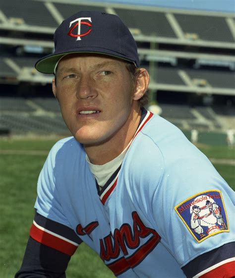

```{r setup, include=FALSE}
knitr::opts_chunk$set(echo = TRUE, message = FALSE, warning = FALSE, fig.align = "center")
```

## Abstract

Do certain positions in baseball have a higher correlation to errors? Are there factors that determine
if a player will play 80 or more games in a season? Does a player having more Gold Gloves and All-Star
game appearances put them in special company in the Baseball Hall of Fame?

Using a logistic regression model, this analysis explores which factors are most correlated with a
fielder being error-prone. A principal component analysis (PCA) is then used to show that a player's
offensive output (hits, runs, RBIs) is closely tied to how many games they play in a season -- i.e.
whether they are an everyday "workhorse." Finally, a K-Means clustering model groups Hall of Fame
players by All-Star appearances and Gold Gloves won, revealing three distinct types of Hall of Famer.

These models were built in R using the publicly available [`Lahman`](https://cran.r-project.org/package=Lahman)
package (Friendly, Dalzell, Monkman, Murphy, Foot, & Zaki-Azat, 2020), which was cross-referenced against
Baseball Reference for validation. The tables used were `Fielding`, `Batting`, `People`, `HallOfFame`,
`AwardsPlayers`, and `AllstarFull`.

> **A note on reproducibility:** the `Lahman` package is updated by its maintainers every season, so this
> document pulls a newer snapshot of the database than the one used when this project was first written in
> 2020. Where the original analysis specified a year range (1999-2018), that filter is applied explicitly
> below so the results stay faithful to the original methodology even as new seasons are added upstream.

```{r libraries}
library(Lahman)
library(tidyverse)
library(FactoMineR)
library(factoextra)
library(plotly)
library(broom)
library(kableExtra)

data(Fielding)
data(Batting)
data(People)
data(HallOfFame)
data(AwardsPlayers)
data(AllstarFull)

nice_table <- function(df, digits = 3, ...) {
  df %>%
    kable(digits = digits, ...) %>%
    kable_styling(bootstrap_options = c("striped", "hover", "condensed"),
                  full_width = FALSE, position = "left")
}
```

---

# Part 1: Are Certain Positions More Error-Prone?

The first question this project explores is whether a fielder being error-prone can be predicted from
factors such as position, games played, assists, double plays turned, league, and year. Fielding data
was pulled for a 20-year window, 1999-2018, a period shaped by the rise of the designated hitter and the
increasing use of defensive shifts.

The fielding table is rich with defensive metrics -- put outs, passed balls, wild pitches, stolen bases,
zone rating, and caught stealing. For this analysis, only errors that apply broadly across all fielding
positions were used, so passed balls, wild pitches, and zone rating were dropped.

```{r fielding-setup}
myInfieldData <- Fielding

# Major league fielding data from the last 20 years used in the original analysis
myRecentInfieldData <- filter(myInfieldData, yearID > 1998, yearID <= 2018)

myALFieldData <- filter(myRecentInfieldData, lgID == "AL")
myNLFieldData <- filter(myRecentInfieldData, lgID == "NL")

myFieldData <- union(myALFieldData, myNLFieldData)

myDataSlimmed <- myFieldData %>%
  select(-WP, -ZR, -playerID, -teamID, -PB, -SB, -stint, -CS)

myDataSlimmed <- na.omit(myDataSlimmed)

# Numeric coding for position, used throughout this project
myDataSlimmed$POS[myDataSlimmed$POS == "P"]  <- 1
myDataSlimmed$POS[myDataSlimmed$POS == "C"]  <- 2
myDataSlimmed$POS[myDataSlimmed$POS == "1B"] <- 3
myDataSlimmed$POS[myDataSlimmed$POS == "2B"] <- 4
myDataSlimmed$POS[myDataSlimmed$POS == "3B"] <- 5
myDataSlimmed$POS[myDataSlimmed$POS == "SS"] <- 6
myDataSlimmed$POS[myDataSlimmed$POS == "OF"] <- 7

myDataSlimmed$POS <- as.numeric(as.character(myDataSlimmed$POS))

myDataClean <- myDataSlimmed
```

*POS key: 1 = pitcher, 2 = catcher, 3 = first base, 4 = second base, 5 = third base, 6 = shortstop,
7 = outfield (a general outfield position -- this dataset does not split left/center/right field).*

## Average Errors by Position

```{r avg-errors}
myAvgErrorData <- myDataClean %>%
  group_by(POS) %>%
  summarise(AvgErrors = mean(E))

nice_table(myAvgErrorData, digits = 2)

ggplot(myAvgErrorData, aes(x = factor(POS), y = AvgErrors)) +
  geom_col(fill = "#2c3e50") +
  labs(x = "Position", y = "Average Errors", title = "Average Errors by Position (1999-2018)") +
  theme_minimal()
```

## Building the Error Indicator

An `ErrorInd` flag was created for each player-season: it is set to `1` when a player committed more
errors than the rounded-up positional average for that season, and `0` otherwise.

```{r error-indicator}
myDataClean$ErrorInd <- ifelse(
  myDataClean$POS == 1 & myDataClean$E > 1 |
  myDataClean$POS == 2 & myDataClean$E > 3 |
  myDataClean$POS == 5 & myDataClean$E > 4 |
  myDataClean$POS == 3 & myDataClean$E > 2 |
  myDataClean$POS == 4 & myDataClean$E > 3 |
  myDataClean$POS == 6 & myDataClean$E > 5 |
  myDataClean$POS == 7 & myDataClean$E > 1,
  1, 0
)
```

## Logistic Regression

The data was split 70/30 into training and test sets, and a logistic regression model was fit using
`ErrorInd` as the response variable against position, games played, assists, double plays, league, and year.

```{r fielding-model}
set.seed(1234)

smp_size <- floor(0.7 * nrow(myDataClean))
train_ind <- sample(seq_len(nrow(myDataClean)), size = smp_size)
train <- myDataClean[train_ind, ]
test  <- myDataClean[-train_ind, ]

fit_log_new <- glm(ErrorInd ~ POS + G + A + DP + lgID + yearID, data = train, family = binomial)
nice_table(broom::tidy(fit_log_new), digits = 4)
```

Position stands out as the strongest factor in the model, followed by games played, assists, and year.
To evaluate the model against the null hypothesis, the null and residual deviance were run through a
chi-squared test:

```{r fielding-chisq}
null_dev  <- fit_log_new$null.deviance
null_df   <- fit_log_new$df.null
resid_dev <- fit_log_new$deviance
resid_df  <- fit_log_new$df.residual

# Null hypothesis check -- expect a very small p-value here
1 - pchisq(null_dev, null_df)

# Residual deviance check -- close to 1 supports a model with a constant term plus these predictors
1 - pchisq(resid_dev, resid_df)
```

The null-deviance test comes back far below 0.05, rejecting the null hypothesis with high confidence.
The residual-deviance test comes back close to 1, which means it is highly plausible that the data
emanate from a logistic regression model built from a constant term plus these five predictors.

## Evaluating Predictive Performance on the Test Set

Fit statistics like deviance describe how well the model explains the training data, not how well it
predicts unseen players. The 30% test set held out above was never actually used for that -- so here it
is, scored against the model's predictions at the standard 0.5 probability threshold:

```{r fielding-test-eval}
test$pred_prob  <- predict(fit_log_new, newdata = test, type = "response")
test$pred_class <- ifelse(test$pred_prob > 0.5, 1, 0)

conf_mat <- table(Actual = test$ErrorInd, Predicted = test$pred_class)
as.data.frame.matrix(conf_mat) %>%
  rownames_to_column("Actual \\\\ Predicted") %>%
  nice_table(digits = 0)

accuracy    <- sum(diag(conf_mat)) / sum(conf_mat)
sensitivity <- conf_mat["1", "1"] / sum(conf_mat["1", ])
specificity <- conf_mat["0", "0"] / sum(conf_mat["0", ])

# Rank-based AUC (equivalent to the Mann-Whitney U statistic) -- computed by hand so this
# doesn't require adding a new package dependency just for one metric
auc_manual <- function(probs, actual) {
  n1 <- sum(actual == 1); n0 <- sum(actual == 0)
  r  <- rank(probs)
  (sum(r[actual == 1]) - n1 * (n1 + 1) / 2) / (n1 * n0)
}
auc_val <- auc_manual(test$pred_prob, test$ErrorInd)

tibble(
  Metric = c("Accuracy", "Sensitivity (catches ErrorInd = 1)",
             "Specificity (catches ErrorInd = 0)", "AUC"),
  Value  = c(accuracy, sensitivity, specificity, auc_val)
) %>%
  nice_table(digits = 3)
```

At 88% accuracy this model looks strong at first glance -- but `ErrorInd` is imbalanced (only about 22%
of test-set players are flagged error-prone), so a model that always guessed "not error-prone" would
already score roughly 78% by doing nothing at all. Sensitivity and specificity tell the more honest
story: at the default 0.5 threshold, the model correctly clears 97% of players who are *not* error-prone
but only catches 56% of the players who *are*. The AUC of 0.90 -- which measures how well the model
ranks error-prone players above non-error-prone ones across *every* possible threshold, not just 0.5 --
is genuinely good and shows the model has real signal; the gap between AUC and sensitivity here is a
threshold problem, not a signal problem. A lower probability cutoff would trade some specificity for a
meaningful gain in sensitivity, which would be the right call if catching error-prone players matters
more than avoiding false alarms.

*Suggested next step: this model could benefit from additional factors such as player age, team, and
more advanced defensive metrics beyond raw error counts. Tuning the classification threshold (or using a
class-weighted model) to trade specificity for sensitivity is also worth exploring, given the imbalance
in `ErrorInd`.*

---

# Part 2: What Makes a Workhorse?

The second question is about a player's durability: which performance factors go hand-in-hand with being
a "workhorse" -- someone who plays in the large majority of their team's games? Principal component
analysis is used below to see which stats move together with workhorse status; PCA is unsupervised, so
it surfaces correlated structure in the data rather than acting as a predictive classifier the way the
logistic regression model in Part 1 does. This analysis was inspired by legendary iron men like Cal
Ripken Jr. and Lou Gehrig.

Like the fielding analysis, this uses data from 1999-2018, but pitchers are excluded. Starting pitchers
typically work on a five-day rotation and relievers appear irregularly, so "games played" doesn't mean
the same thing for pitchers as it does for everyday position players.

```{r workhorse-setup}
myPositionData <- filter(Fielding, yearID > 1998, yearID <= 2018)

myPositionPlayer <- myPositionData %>%
  select(yearID, POS, playerID, G) %>%
  filter(POS != "P")

as.data.frame(t(as.matrix(unclass(summary(myPositionPlayer$G))))) %>%
  nice_table(digits = 1)
```

## Average Games Played, by Position

```{r games-by-position}
myavgGames <- myPositionPlayer %>%
  group_by(playerID, yearID) %>%
  summarise(G = sum(G), .groups = "drop")

myavgGamesByPos <- myPositionPlayer %>%
  group_by(playerID, yearID, POS) %>%
  summarise(G = sum(G), .groups = "drop")

myavgGamesByPosViz <- myPositionPlayer %>%
  group_by(POS) %>%
  summarise(G = mean(G))

ggplot(myavgGamesByPosViz, aes(x = factor(POS), y = G)) +
  geom_col(fill = "#2c3e50") +
  labs(x = "Position", y = "Average Games Played", title = "Average Games Played by Position") +
  theme_minimal()
```

Across all position players, the average games played per season comes out to roughly 41 games -- far
lower than expected. Doubling that figure gives a round threshold of **80 games**, which becomes the
cutoff for the `WH` (workhorse) indicator: a player who appears in more than 80 games in a season is
flagged as a workhorse.

```{r workhorse-flag}
myavgGames$WH <- ifelse(myavgGames$G > 79, 1, 0)
```

*Yadier Molina's data was used throughout this build-out as a validation baseline to make sure every
join and merge behaved as expected.*

## Assembling the Modeling Dataset

Player age, batting stats (hits, runs, stolen bases, RBIs, walks, strikeouts), and fielding totals
(assists, errors, double plays) were joined onto the games-played data to build the final dataset for
principal component analysis.

```{r workhorse-join}
myPlayerPrimaryPosition <- myavgGamesByPos %>%
  group_by(playerID, yearID) %>%
  filter(G == max(G)) %>%
  arrange(playerID, yearID, POS)

mycleanPrimaryData <- myPlayerPrimaryPosition %>%
  select(playerID, yearID, POS)

myPlayerGames <- merge(myavgGames, People, by = "playerID")

myPlayerAge <- myPlayerGames %>%
  select(playerID, yearID, G, WH, birthYear)
myPlayerAge$age <- myPlayerAge$yearID - myPlayerAge$birthYear
myPlayerAge <- myPlayerAge %>% select(playerID, yearID, G, WH, age)

myPlayerAge$yearPlayer <- paste(myPlayerAge$playerID, myPlayerAge$yearID)
mycleanPrimaryData$yearPlayer <- paste(mycleanPrimaryData$playerID, mycleanPrimaryData$yearID)

myCombinedData <- merge(x = mycleanPrimaryData, y = myPlayerAge, by = "yearPlayer", all.x = TRUE)

myData1 <- myCombinedData %>%
  select(playerID.x, yearID.x, POS, G, WH, age) %>%
  rename(yearID = yearID.x, playerID = playerID.x)

myBattingData <- filter(Batting, yearID > 1998, yearID <= 2018)

myTestBattingData <- myBattingData %>%
  select(playerID, yearID, H, R, SB, RBI, BB, SO)
myTestBattingData$playerYear <- paste(myTestBattingData$playerID, myTestBattingData$yearID)

myTestBattingDataClean <- myTestBattingData %>%
  select(playerID, yearID, playerYear, H, R, SB, RBI, BB, SO)

myFieldData <- myPositionData %>%
  select(playerID, yearID, A, E, DP)

myFieldDataSummarized <- myFieldData %>%
  group_by(playerID, yearID) %>%
  summarise(A = sum(A), E = sum(E), DP = sum(DP), .groups = "drop")
myFieldDataSummarized$playerYear <- paste(myFieldDataSummarized$playerID, myFieldDataSummarized$yearID)

myData2 <- merge(x = myFieldDataSummarized, y = myTestBattingDataClean, by = "playerYear", all.x = TRUE) %>%
  select(playerYear, playerID.x, A, E, DP, H, R, RBI, BB, SO) %>%
  rename(player_ID = playerID.x)

myData1$playerYear <- paste(myData1$playerID, myData1$yearID)

myFinalData <- merge(x = myData1, y = myData2, by = "playerYear", all.x = TRUE) %>%
  select(playerID, yearID, POS, G, WH, age, A, E, DP, H, R, RBI, BB, SO) %>%
  na.omit() %>%
  select(yearID, POS, age, G, WH, A, E, DP, H, R, RBI, BB, SO)

myFinalData$POS[myFinalData$POS == "P"]  <- 1
myFinalData$POS[myFinalData$POS == "C"]  <- 2
myFinalData$POS[myFinalData$POS == "1B"] <- 3
myFinalData$POS[myFinalData$POS == "2B"] <- 4
myFinalData$POS[myFinalData$POS == "3B"] <- 5
myFinalData$POS[myFinalData$POS == "SS"] <- 6
myFinalData$POS[myFinalData$POS == "OF"] <- 7
myFinalData$POS <- as.numeric(as.character(myFinalData$POS))

df <- myFinalData
nice_table(head(df))
```

## Workhorses by Position

```{r workhorse-viz}
myWHViz <- df %>%
  filter(WH == 1) %>%
  group_by(POS) %>%
  summarise(G = mean(G))

ggplot(myWHViz, aes(x = factor(POS), y = G)) +
  geom_col(fill = "#c0392b") +
  labs(x = "Position", y = "Average Games Played", title = "Average Games Played by Workhorse Players") +
  theme_minimal()
```

Once restricted to players who cleared the 80-game workhorse threshold, the average games-played figure
by position looks much closer to what a fan would expect from an everyday player.

## Principal Component Analysis

```{r pca}
df_model <- df[-1] # drop yearID label column not needed for PCA input ordering

set.seed(42)
samp <- sample(nrow(df_model), nrow(df_model) * 0.8)
training <- df_model[samp, ]
testing  <- df_model[-samp, ]

df.pca <- prcomp(training[, -4], center = TRUE, scale. = TRUE) # remove WH; center & scale
summary(df.pca)
plot(df.pca, type = "l", main = "PCA Variance by Component")

res.pca <- PCA(training[, -4], graph = FALSE)
get_eig(res.pca) %>%
  as.data.frame() %>%
  rownames_to_column("Dimension") %>%
  nice_table(digits = 2)
```

The first three dimensions account for roughly 75% of the variation in the model -- a substantial share.

```{r pca-viz}
fviz_screeplot(res.pca, addlabels = TRUE)

fviz_contrib(res.pca, choice = "var", axes = 1, top = 10)
fviz_contrib(res.pca, choice = "var", axes = 2, top = 10)
fviz_contrib(res.pca, choice = "var", axes = 3, top = 10)

fviz_cos2(res.pca, choice = "var", axes = 1:2)
```

The `cos2` chart (a technique recommended by STHDA -- Statistical Tools for High-Throughput Data
Analysis) makes it easiest to see which variables matter most across the first two dimensions: offensive
metrics -- runs, hits, and RBIs -- stand out as the variables most strongly associated with the
components that separate workhorse-level players from the rest.

*Suggested next step: the 80-game workhorse threshold was derived from one overall average across all
positions. A position-specific average, doubled, might produce a more meaningful cutoff per position.*

---

# Part 3: Clustering the Hall of Fame

The final part of this project looks at Hall of Fame position players and clusters them by All-Star
selections and Gold Glove awards using K-Means. This was partly inspired by a randomForest-based
Hall of Fame classification analysis from the *Exploring Baseball Data* blog (bmmills, 2014).

Because the first All-Star Game was played in 1933 but the first Gold Gloves were not awarded until
1957, the analysis is restricted to Hall of Famers whose careers extended past 1957 so that both awards
were possible during their playing days.

```{r hof-setup}
myDataHOF <- HallOfFame %>%
  select(playerID, votedBy, ballots, needed, votes, needed_note) %>%
  filter(HallOfFame$inducted == "Y" & HallOfFame$category == "Player")

myDataPlayerAwards <- AwardsPlayers
myDataAllStar <- AllstarFull

myDataHOF <- merge(myDataHOF, People, by = "playerID")

myDetailHOFData <- myDataHOF %>%
  select(playerID, nameFirst, nameLast, votedBy, ballots, needed, votes, needed_note,
         weight, height, bats, throws, birthCity, birthState, debut, finalGame)

# Players excluded because their careers ended before Gold Gloves existed
myDataHOFHist <- myDetailHOFData %>%
  select(playerID, nameFirst, nameLast) %>%
  filter(myDetailHOFData$finalGame < "1957-01-01")
nrow(myDataHOFHist)

myDataHOF <- myDetailHOFData %>%
  select(playerID, nameFirst, nameLast) %>%
  filter(myDetailHOFData$finalGame > "1957-01-01")
nrow(myDataHOF)

myDataHOF$Name <- paste(myDataHOF$nameFirst, myDataHOF$nameLast)
myDataHOF <- myDataHOF %>% select(playerID, Name)
```

## Gold Gloves and All-Star Appearances

```{r hof-awards}
myGoldGLoves <- myDataPlayerAwards %>%
  subset(awardID == "Gold Glove") %>%
  count(playerID) %>%
  rename(GoldGLoves = n)

myAllStarDataTrend <- myDataAllStar %>%
  count(playerID) %>%
  rename(AllStarGames = n)

myDataHOF <- merge(x = myDataHOF, y = myAllStarDataTrend, by = "playerID", all.x = TRUE)
myDataHOF <- merge(x = myDataHOF, y = myGoldGLoves, by = "playerID", all.x = TRUE)

myDataHOF <- myDataHOF %>% select(Name, AllStarGames, GoldGLoves)
myDataHOF[is.na(myDataHOF)] <- 0

mydata_tib <- as_tibble(myDataHOF)
```

## Choosing the Number of Clusters

Rather than assuming three clusters, silhouette width is checked across a range of `k` to see what the
data itself supports:

```{r hof-nbclust}
x_check <- as.data.frame(mydata_tib[2:3])
rownames(x_check) <- mydata_tib$Name

set.seed(1234)
fviz_nbclust(x_check, kmeans, method = "silhouette", k.max = 8) +
  labs(title = "Silhouette Width by Number of Clusters")
```

`k = 2` edges out `k = 3` on silhouette width (0.53 vs. 0.51), and both sit well above every larger `k`
-- so the data doesn't strongly demand three groups over two. Checking what each `k` actually does to
the players confirms `k = 3` is still the more useful choice: at `k = 2`, the model only separates
"low-award" from "high-award" players by raw total, which lumps pure hitters like Hank Aaron and Stan
Musial (many All-Star nods, almost no Gold Gloves) into the same cluster as glove-first players like
Greg Maddux and Jim Kaat (many Gold Gloves, comparatively few All-Star nods) -- two very different
profiles that happen to add up to a similar award count. Moving to `k = 3` splits exactly that group in
two, separating the All-Star-heavy hitters from the Gold-Glove-heavy defenders. That's a real
qualitative gain even though it costs a small amount of silhouette width, which is why `k = 3` is used
below -- but it's worth stating as a deliberate interpretability trade-off rather than the
statistically-optimal choice.

## K-Means Clustering

A plain scatterplot of this data fights an uphill battle: dozens of Hall of Famers sit at or near zero
Gold Gloves and zero All-Star games, so static point labels pile on top of each other no matter how
they're nudged. Instead, points below are lightly jittered for visual separation, shaded by a convex
hull per cluster, and made interactive with `plotly` -- hover over any point to see exactly who it is.

```{r hof-kmeans}
set.seed(1234)
y <- mydata_tib$Name
x <- as.data.frame(mydata_tib[2:3])
rownames(x) <- y

k_means_fit <- kmeans(x, 3)

plot_df <- x
plot_df$Name <- y
plot_df$Cluster <- factor(k_means_fit$cluster)

plot_df %>%
  group_by(Cluster) %>%
  summarise(Players = n(), Names = paste(sort(Name), collapse = ", ")) %>%
  nice_table() %>%
  column_spec(3, width = "34em")

hulls_km <- plot_df %>%
  group_by(Cluster) %>%
  slice(chull(AllStarGames, GoldGLoves))

set.seed(1)
p_kmeans <- ggplot(plot_df, aes(
    x = AllStarGames, y = GoldGLoves, color = Cluster, fill = Cluster,
    text = paste0(Name, "<br>All-Star Games: ", AllStarGames, "<br>Gold Gloves: ", GoldGLoves)
  )) +
  geom_polygon(data = hulls_km, alpha = 0.12, color = NA) +
  geom_jitter(width = 0.15, height = 0.15, size = 2.5, alpha = 0.85) +
  scale_color_brewer(palette = "Dark2") +
  scale_fill_brewer(palette = "Dark2") +
  labs(title = "K-Means: Hall of Famers by All-Star Games and Gold Gloves",
       x = "All-Star Games", y = "Gold Gloves") +
  theme_minimal(base_size = 12)

ggplotly(p_kmeans, tooltip = "text")
```

Hank Aaron and Stan Musial stand out for All-Star appearances, Brooks Robinson hits the sweet spot of
many Gold Gloves and many All-Star games, and Greg Maddux is the clear standout for Gold Gloves with a
strong handful of All-Star appearances too. The convex hulls make the three clusters -- the
All-Star-heavy group, the balanced-awards group, and the low-award majority -- easy to tell apart at a
glance, while hover text still gives the exact player behind any point.

## Hierarchical Clustering for a Clearer View

```{r hof-hclust}
d <- dist(x, method = "euclidean")
hc1 <- hclust(d, method = "complete")
sub_grp <- cutree(hc1, k = 3)

plot_df2 <- x
plot_df2$Name <- y
plot_df2$Cluster <- factor(sub_grp)

plot_df2 %>%
  group_by(Cluster) %>%
  summarise(Players = n(), Names = paste(sort(Name), collapse = ", ")) %>%
  nice_table() %>%
  column_spec(3, width = "34em")

hulls_hc <- plot_df2 %>%
  group_by(Cluster) %>%
  slice(chull(AllStarGames, GoldGLoves))

set.seed(2)
p_hclust <- ggplot(plot_df2, aes(
    x = AllStarGames, y = GoldGLoves, color = Cluster, fill = Cluster,
    text = paste0(Name, "<br>All-Star Games: ", AllStarGames, "<br>Gold Gloves: ", GoldGLoves)
  )) +
  geom_polygon(data = hulls_hc, alpha = 0.12, color = NA) +
  geom_jitter(width = 0.15, height = 0.15, size = 2.5, alpha = 0.85) +
  scale_color_brewer(palette = "Set1") +
  scale_fill_brewer(palette = "Set1") +
  labs(title = "Hierarchical Clustering of Hall of Famers",
       x = "All-Star Games", y = "Gold Gloves") +
  theme_minimal(base_size = 12)

ggplotly(p_hclust, tooltip = "text")
```

Plotting hierarchical clusters in the original All-Star/Gold-Glove units (rather than `fviz_cluster`'s
default PCA-rotated axes) keeps this plot directly comparable to the K-Means plot above. The split
tells a similar story from a different algorithm: a small high-Gold-Glove group anchored by Greg Maddux
and Jim Kaat, a balanced-awards middle group, and a large group of Hall of Famers who got in on the
strength of their overall career rather than All-Star nods or Gold Gloves.

*Suggested next step: this clustering only considers two award types. Since Gold Gloves weren't awarded
until 1957, a meaningful number of Hall of Famers are excluded outright -- a limitation worth keeping in
mind when generalizing these clusters to "greatness" as a whole.*

## Update: Jim Kaat's 2022 Hall of Fame Election

> **Disclaimer:** In December 2021, the Golden Days Era Committee elected Jim Kaat to the Baseball Hall
> of Fame, and he was formally inducted in July 2022 -- after this project's original analysis was
> written. The hierarchical clustering above already places him alongside Greg Maddux in the small,
> high-Gold-Glove cluster, so his eventual induction lines up neatly with the grouping this model
> produced.

```{r jim-kaat-photo, echo=FALSE, out.width="40%", fig.cap="Jim Kaat, elected to the Baseball Hall of Fame in 2022, clusters alongside Greg Maddux in this analysis."}

```

---

# Presentation Slides

This project was also delivered as a slide presentation. Rather than reproduce all 19 slides inline here,
they're published as their own click-through deck:

**[View the presentation slides &rarr;](https://rstudio-pubs-static.s3.amazonaws.com/1451780_cd15c6dd2cae40ae9451e8925fdc299e.html)**

*Linked directly to the slide file rather than the RPubs page: RPubs wraps presentations in its
own header/footer toolbars around an iframe, which fights with ioslides' own click/keyboard
navigation and makes the deck feel like it's "doubling up." This link opens the deck standalone
with no extra chrome.*

---

# Conclusion

This project set out to make a few intelligent inferences from publicly available baseball data:

- **Errors** are most strongly predicted by **position**, followed by games played, assists, and year --
  and the logistic regression model clears the chi-squared significance bar with room to spare.
- **Workhorse status** (80+ games in a season) is closely tied to **offensive production** -- runs, hits,
  and RBIs carry the most weight in the PCA model, more than fielding or age.
- **Hall of Fame players** cluster into recognizable archetypes based on All-Star appearances and Gold
  Gloves: pure hitters with many All-Star nods and few Gold Gloves, well-rounded stars with both, and at
  least one player (Greg Maddux) who is a category of his own.

A general critique across all three analyses: each model uses a relatively small set of factors given
what's available in the Lahman database. Team context, more granular defensive metrics, and a
position-specific workhorse threshold are the most promising directions for extending this project.

This analysis is aimed at a general audience: baseball knowledge helps make the results land, but isn't
required to follow the statistics.

## References

- bmmills. (2014, November 26). *Hall of Fame Classification Using randomForest*. Retrieved from
  <https://baseballwithr.wordpress.com/2014/11/26/hall-of-fame-classification-using-randomforest/>
- Friendly, M., Dalzell, C., Monkman, M., Murphy, D., Foot, V., & Zaki-Azat, J. (2020). *Package 'Lahman'*.
  Retrieved from <https://cran.r-project.org/web/packages/Lahman/Lahman.pdf>
- Visitor, T., Agathe, Enrique, & Julie. (2017, September 23). *PCA - Principal Component Analysis
  Essentials*. Retrieved from
  <http://www.sthda.com/english/articles/31-principal-component-methods-in-r-practical-guide/112-pca-principal-component-analysis-essentials/>
- Yadier Molina Stats. Retrieved from <https://www.baseball-reference.com/players/m/molinya01.shtml>
